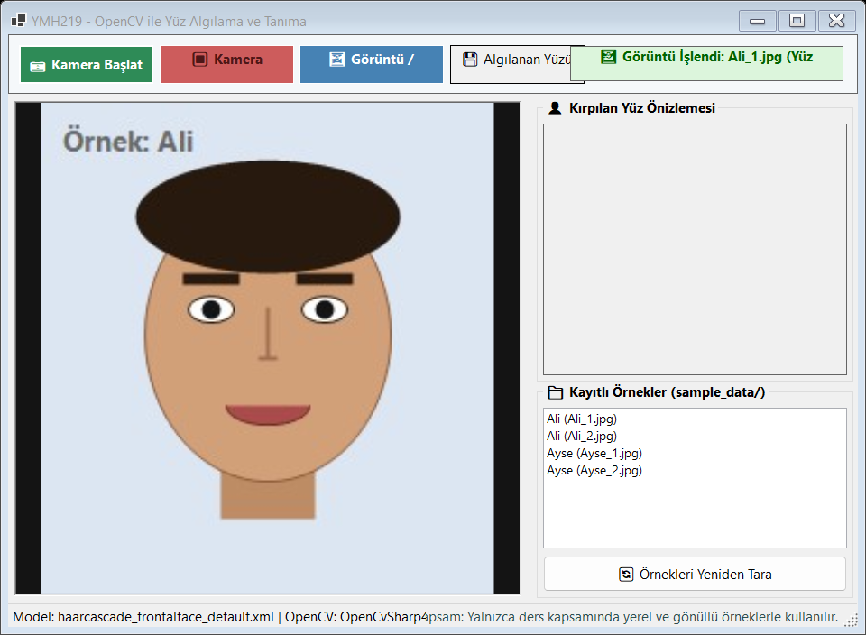
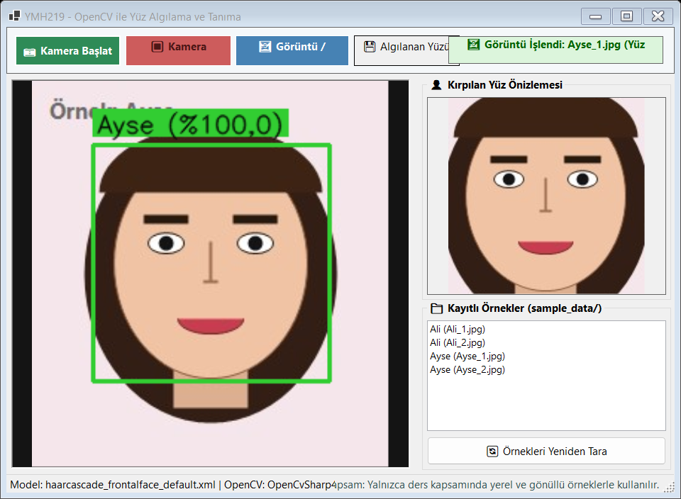

# YMH219 - OpenCV ile Yüz Algılama ve Tanıma

Bu proje, Fırat Üniversitesi **Nesne Tabanlı Programlama (YMH 219)** dersi kapsamında Windows Forms ortamında C# ve OpenCV (`OpenCvSharp4`) kütüphanesi kullanılarak geliştirilmiş yüz algılama (Face Detection) ve yüz tanıma (Face Recognition) masaüstü uygulamasıdır.

---

## 📌 Projenin Amacı ve Kısa Açıklama

Projenin temel amacı; görüntü işleme ve bilgisayarla görme (Computer Vision) kavramlarını nesne yönelimli mimariyle uygulamak, Haar Cascade sınıflandırıcısı ile yüz bölgesini gerçek zamanlı tespit etmek ve yerel örnek veri kümesi üzerinden kişi tanıma/etiketleme demonstrasyonu gerçekleştirmektir. Uygulama hem **canlı kamera akışından** hem de **bilgisayardan seçilen resim dosyalarından** görüntü işleme yapabilmektedir.

---

## 🛡️ Kapsam ve Güvenlik Sınırı

> **Önemli Güvenlik ve Etik Bildirimi (Föy Yönergesi):**
> Bu çalışma yalnızca ders kapsamında yerel ve gönüllü örneklerle yapılmalıdır. Kamuya açık alanlarda izinsiz kimlik takibi, gizli görüntü toplama veya gerçek kişileri uzaktan izlemeye yönelik kullanım **kesinlikle yapılmamalıdır**.
>
> Gizlilik nedeniyle gerçek kişilere ait yüz örnekleri bu depoya **eklenmemiştir**; örnekler yalnızca uygulamanın çalıştığı bilgisayarda saklanır.

---

## 🛠️ Kullanılan Teknolojiler ve Kütüphaneler

- **Programlama Dili:** C# (.NET 10.0 / Windows Desktop SDK)
- **Görüntü İşleme Kütüphanesi (NuGet):** OpenCvSharp4 (v4.13.0)
  - `OpenCvSharp4` (Çekirdek OpenCV motoru)
  - `OpenCvSharp4.Windows` (Yerel Windows C++ kütüphane bağlayıcıları)
  - `OpenCvSharp4.Extensions` (OpenCV Mat ve Windows Forms Bitmap dönüşümü)
- **Yüz Algılama Modeli:** Haar Cascade Sınıflandırıcısı (`haarcascade_frontalface_default.xml`)
- **Yüz Tanıma Yöntemi:** 100x100 gri seviye, histogram eşitlenmiş yüzler arasında normalleştirilmiş çapraz korelasyon (`Cv2.MatchTemplate`, `CCoeffNormed`)
- **Arayüz:** Windows Forms (WinForms, PictureBox, ListView, SplitContainer, FlowLayoutPanel)
- **Sürüm Kontrolü:** Git & GitHub

---

## 🚀 Kurulum ve Çalıştırma Adımları

### Gereksinimler
- Windows 10 veya Windows 11
- [.NET 10 SDK](https://dotnet.microsoft.com/download/dotnet/10.0)
- Visual Studio 2026 (".NET masaüstü geliştirme" iş yükü) **veya** komut satırı için yalnızca .NET 10 SDK
- İsteğe bağlı: web kamerası (yoksa resim dosyalarıyla çalışılabilir)

> Proje `net10.0-windows` hedeflediği için Visual Studio 2022 ile açılamaz. NuGet paketleri ilk derlemede otomatik indirilir.

### Çalıştırma
1. Projeyi bilgisayarınıza klonlayın:
   ```bash
   git clone https://github.com/BirgulGokturk/YMH219-FaceRecognition.git
   cd YMH219-FaceRecognition
   ```
2. Projeyi derleyin ve çalıştırın:
   ```bash
   dotnet build
   dotnet run
   ```
   *Veya `YMH219_FaceRecognition.sln` dosyasını Visual Studio ile açarak F5 tuşu ile başlatabilirsiniz.*

### Kullanım
- **Kendi örneklerinizi ekleme (tanıma için önerilen yol):**
  1. "📷 Kamera Başlat" ile kamerayı açın (veya "🖼️ Görüntü / Resim Seç" ile bir fotoğraf seçin).
  2. Sağ alttaki kutuya kişinin adını yazın (yalnızca harf ve rakam, örn: `Birgul`).
  3. Yüz önizlemede görünürken **"➕ Örnek Ekle"** butonuna basın. Farklı açı/ışık koşullarında 2–3 örnek eklemek tanımayı iyileştirir.
  4. Aynı işlemi ikinci bir kişi (gönüllü) için tekrarlayın. Eklenen yüzler kamerada anında etiketlenir.
- **Resim dosyası ile test (kamera olmayan cihazlar için):**
  - "🖼️ Görüntü / Resim Seç" butonuyla bir fotoğraf seçin; yüz yeşil dikdörtgenle işaretlenir, kişi adı ve güven skoru gösterilir.
- **Hazır örnekler:** Uygulama ilk açılışta, kamera ve örnek olmadan da denenebilmesi için `sample_data/` klasörüne iki çizim örnek sınıf (`Ali`, `Ayse`) oluşturur.

---

## ⚙️ Uygulamanın Temel Özellikleri

### 1. Asgari Gereksinimler
- **Kamera ve Dosya Desteği:** Canlı webcam görüntüsü veya bilgisayardan seçilen fotoğraf (`.jpg`, `.png`, `.bmp`) PictureBox üzerinde görüntülenir. Kamera Başlat/Durdur ve Görüntü Seç butonları bulunur.
- **Yüz Bölgesi İşaretleme:** Algılanan yüzler sınırlayıcı dikdörtgen (`Cv2.Rectangle`) ile işaretlenir (tanınan kişi yeşil, bilinmeyen sarı).
- **Etiket ve Güven Skoru:** Tanınan kişinin adı ve yüzde benzerlik/güven skoru hem yüzün üstünde hem de sağdaki "Yüz Tanıma Sonuçları" tablosunda (kişi, güven, konum) gösterilir. Benzerlik %45'in altındaysa yüz "Bilinmiyor" olarak etiketlenir.
- **Yerel Örnek Küme (En Az İki Sınıf):** "Örnek Ekle" ile kendi yüzünüzün ve gönüllülerin örnekleri eklenir; örnekler `sample_data/` klasöründe `KisiAdi_zaman.jpg` olarak saklanır. Alt klasör düzeni de desteklenir (`sample_data/KisiAdi/resim.jpg`).
- **Hata ve Donanım Kontrolü:** Kamera bulunamadığında veya model dosyası eksik olduğunda uygulama çökmez, kullanıcıya açıklayıcı hata ve yönlendirme mesajı gösterir.

### 2. İsteğe Bağlı / Ek Geliştirmeler (Bonus)
- ➕ **Basit Veri Ekleme Ekranı:** "Örnek Ekle" ile kamera veya resimden yeni kişi örnekleri uygulama içinden eklenir.
- 💾 **Algılanan Yüzü Kaydetme:** "💾 Algılanan Yüzü Kaydet" butonu ile tespit edilen yüz kırpılarak `saved_faces/` klasörüne zaman damgalı olarak kaydedilir.
- 👥 **Çoklu Yüz Algılama:** Aynı karede birden fazla yüz varsa her biri ayrı ayrı dikdörtgen içine alınır ve etiketlenir.
- 🔄 **Örnekleri Yeniden Tarama:** "🔄 Örnekleri Yeniden Tara" butonu `sample_data/` klasörünü baştan okur; klasöre elle eklenen fotoğraflar tanımaya dahil edilir (örnekler çoğalmaz).
- 🧵 **Thread Güvenli Kamera İşleme:** Kameradan gelen kareler arka plan thread'inde işlenir; her kare için oluşturulan sonuç listesi arayüz thread'ine devredilir ve OpenCV `Mat` nesneleri açıkça serbest bırakılır.

---

## 📸 Ekran Görüntüleri

| Yüz Tespiti ve Tanıma | Örnek Ekleme ve Sonuç Listesi |
|:---:|:---:|
|  |  |

---

## 🏗️ Nesne Tabanlı Mimari

```
YMH219-FaceRecognition/
├── Models/
│   ├── DetectedFace.cs                     # Tespit edilen yüz koordinatları, etiket ve güven skoru
│   ├── FaceSample.cs                       # Tanıma veri setindeki referans yüz modeli
│   └── haarcascade_frontalface_default.xml # OpenCV yüz tespit modeli (derlemede bin/.../models/ klasörüne kopyalanır)
├── Services/
│   ├── FaceDetectionService.cs             # Haar Cascade yüz tespit sınıfı
│   ├── FaceRecognitionService.cs           # Örnek yükleme/ekleme, şablon eşleme ve güven skoru
│   └── CameraService.cs                    # Arka planda VideoCapture ve kamera kontrol servisi
├── screenshots/
│   ├── ekran1.png
│   └── ekran2.png
├── Form1.cs                                # Form olayları, görüntü işleme akışı ve UI bağlama
├── Form1.Designer.cs                       # Görüntü paneli, sonuç listesi ve butonlar
├── SampleDataGenerator.cs                  # İlk açılışta çizim örnek veri oluşturucu
├── Program.cs                              # Giriş noktası
├── YMH219_FaceRecognition.csproj
└── YMH219_FaceRecognition.sln
```

Çalışma sırasında uygulama klasöründe (`bin/Debug/net10.0-windows/`) şu klasörler oluşur: `models/` (Haar modeli), `sample_data/` (tanıma örnekleri), `saved_faces/` (kaydedilen yüzler).

---

## 📝 Bilinen Sınırlamalar / Geliştirme Notları

- Tanıma, basit bir şablon eşleme (normalleştirilmiş korelasyon) yöntemidir; ışıklandırma, yüz eğimi, gözlük ve kamera çözünürlüğü sonucu belirgin şekilde etkiler. Bu nedenle her kişi için farklı koşullarda birkaç örnek eklenmesi önerilir.
- Örnekler derleme çıktısı klasöründe (`bin/.../sample_data/`) tutulur; `bin` klasörü silinirse eklenen örnekler de silinir.
- Gelecek versiyonlarda OpenCV'nin LBPH yüz tanıyıcısı veya derin öğrenme tabanlı modeller (DNN / FaceNet) entegre edilebilir.

---

## 👤 Öğrenci Bilgileri

- **Adı Soyadı:** Birgül Göktürk
- **Öğrenci Numarası:** 250541094
- **Ders:** Nesne Tabanlı Programlama (YMH 219)
- **Dönem:** 2026-2027 Güz
